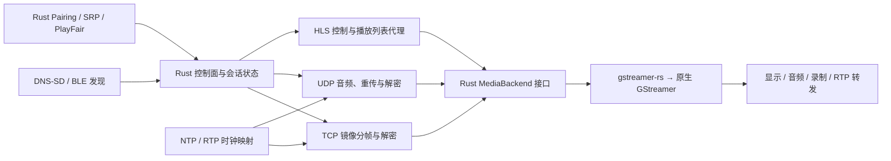

**UxPlay 完整 Rust 移植可行性研究**

研究日期：2026-09-19。研究对象：[FDH2/UxPlay](https://github.com/FDH2/UxPlay)，固定提交 [`57ea83411d5f7e0b38c5841987439340543f025c`](https://github.com/FDH2/UxPlay/tree/57ea83411d5f7e0b38c5841987439340543f025c)，提交日期 2026-09-17，README 自述版本为 **1.74 Experimental**。这是开发分支快照，不应表述为已验证的稳定发布版。

**结论：将 UxPlay 自身的应用、协议、配对、PlayFair、缓冲同步和外围功能全部改写为 Rust，保留 GStreamer 与必要的系统 API，是技术上可行且值得开展验证的工程。将整个媒体技术栈也要求为纯 Rust，则不能用同一预算和进度承诺完整对等。**

本次完成了源码获取、目录与依赖审计、关键协议路径阅读、源文件规模统计，以及候选 Rust 库的官方资料核查。未编译或运行 UxPlay，未实现 Rust 接收器，未进行 iPhone/iPad/Mac 实机互操作、抓包或性能测试。下文的“源码已确认”“候选方案”“工程估算”分别表示不同证据强度。

**1. “完全移植”的边界**

| 目标 | 完成后的实际形态 | 判断 |
|---|---|---|
| Rust 外壳 | CLI 和配置使用 Rust，内部仍调用 UxPlay 的 C 协议库或 C PlayFair | 可用于过渡，但不算自身代码完整移植 |
| UxPlay 自身实现全部 Rust 化 | 协议、密钥处理、PlayFair、应用与蓝牙脚本逻辑均为 Rust；通过 Rust binding 调用 GStreamer 和系统服务 | 推荐目标，可实现功能对等；仍存在原生依赖与 FFI |
| 用户态依赖也全部纯 Rust | 进一步替代 GStreamer、视频解码、AAC-ELD、HLS 播放链、录制和平台媒体适配；系统调用边界另行定义 | 本次未找到足以证明完整替代的现成组合，不宜作为首个交付目标 |

第二种目标不要求把操作系统、驱动或 GStreamer 本身重写。第三种目标也不能笼统要求“零系统 FFI”：网络、显示和音频设备最终都需要系统接口。应明确区分“没有 UxPlay C 源文件”“没有第三方 C 媒体库”“核心 crate 禁用 unsafe”。

功能对等应限定为上述固定提交在约定设备和平台上的行为，不是苹果 AirPlay 全部能力，也不是对未来 iOS/macOS 的兼容保证。源码明确没有 AirPlay 2 多房间音频支持，受保护的视频内容也不在现有能力内。[S1][S3]

**2. 实际需要迁移的范围**

| 功能 | 上游依据 | 完整移植的要求 |
|---|---|---|
| 服务发现 | `lib/dnssd.c`、`lib/mdnsd/`、`lib/dns_sd/` | `_airplay._tcp` / `_raop._tcp` 注册、TXT 能力位、设备身份、端口和接口管理 |
| HTTP/RTSP 控制面 | `lib/httpd.c`、`lib/http_request.c`、`lib/raop.c` | 增量解析、连接分类、CSeq、请求路由、反向 HTTP、错误与断线处理 |
| 配对和访问控制 | `lib/pairing.c`、`lib/srp.c`、`lib/raop_handlers.h`、`uxplay.cpp` | 旧式配对、PIN、密码、注册客户端、身份密钥持久化、允许/拒绝名单 |
| FairPlay 会话密钥处理 | `lib/fairplay_playfair.c`、`lib/playfair/` | `/fp-setup` 握手与会话 AES 密钥解包；不能用普通 AES 库直接替代整模块 |
| 屏幕镜像 | `lib/raop_rtp_mirror.c`、`lib/mirror_buffer.c` | TCP 分帧、AES-CTR、H.264/H.265、参数集、分辨率变化、暂停与恢复 |
| 音频流 | `lib/raop_rtp.c`、`lib/raop_buffer.c` | UDP RTP、重传/乱序处理、AES-CBC、AAC-ELD/AAC-LC/ALAC、FLUSH 和音量 |
| 时钟同步 | `lib/raop_ntp.c` | NTP 时间映射、过滤和偏移修正、RTP 时钟换算、平台接收时间戳 |
| HLS / URL 视频 | `lib/http_handlers.h`、`lib/fcup_request.h`、`lib/airplay_video.c` | 反向请求、播放列表代理和重写、语言/字幕选择、播放进度与控制 |
| 渲染与导出 | `renderers/` | GStreamer 管线、硬件解码选择、音画同步、封面、MP4 录制、RTP 转发 |
| 应用和平台集成 | `uxplay.cpp`、`Bluetooth_LE_beacon/` | CLI、配置、日志、蓝牙广播、Linux 屏保抑制、服务部署、macOS AWDL |

上游称 Windows 在 MSYS2/MinGW 环境构建运行；构建 workflow 覆盖 Linux、macOS、Windows x64 和 ARM64。README 还描述 BSD 和 Raspberry Pi。完整跨平台对等需为这些目标建立明确验收矩阵，不能用一次 Windows 演示代替。[S1][S14]

这里有两项影响范围的版本差异：

- 1.74 实验版在非 macOS 平台默认启用内部 mDNS 实现；macOS 默认仍用 Bonjour。因此“原版必须依赖 Avahi/Bonjour”对本次快照并不成立。[S2]
- README 仍称 HLS 仅支持 YouTube iOS、浏览器 AirPlay 不支持，但 `http_handler_play` 已有 `http://` / `https://` 的直接 `Content-Location` 播放分支，并注释提及 Safari。可以确认代码路径存在；不能在未实测情况下宣称任意 Safari 视频已稳定支持。应将此路径列入验收，而不是照抄旧 README 的限制。[S1][S10]

**3. 代码规模与工程含义**

统计范围为 `.c/.h/.cpp/.py`，使用物理行数，包含空行、注释和数据表，不是逻辑 SLOC。重跑脚本见 [measure-upstream.ps1](D:/Projects/rust-airplay/research/measure-upstream.ps1)，逐文件结果见 [source-inventory.csv](D:/Projects/rust-airplay/research/evidence/source-inventory.csv)。

| 分组 | 文件数 | 物理行数 |
|---|---:|---:|
| 应用入口 `uxplay.cpp` | 1 | 3,424 |
| 协议、配对、SRP 与公共工具 | 48 | 14,438 |
| 两套服务发现后端 | 4 | 2,007 |
| 渲染与录制 | 7 | 2,303 |
| PlayFair | 7 | 1,267 |
| 蓝牙 Python 工具 | 5 | 1,298 |
| 内嵌 llhttp | 4 | 11,881 |
| 合计 | 76 | 36,618 |

扣除可由 Rust 解析层替代、无需机械翻译的 llhttp 后，仍有约 **24,737 行**原始材料。该数包含可替代的通用代码，不能直接换算为 Rust 开发量。另一方面，`lib/playfair/omg_hax.h` 仅少量长行却占 **483,271 字节**，主要为常量表；只看行数会误判密码模块的体积与结构。

整体规模适合小团队重构。真正影响交付的是协议状态、客户端差异、时序和媒体后端行为，而不是语法翻译。检视的仓库有编译与二进制存在性检查 workflow，但未发现独立的协议回归、密码差分或 fuzz 测试套件；不能假定上游已经提供可直接继承的完整测试基础。[S14]

**4. 模块可行性与候选依赖**

| 模块 | Rust 方案 | 难度 | 需要验证的边界 |
|---|---|---|---|
| 网络与任务管理 | `tokio`、`bytes`、`socket2`，会话独占状态 | 中 | TCP 断流、UDP 乱序、取消流程、接口选择；异步运行时不是硬实时系统 |
| mDNS/DNS-SD | `mdns-sd`；macOS P2P 保留 Bonjour 专用适配 | 中 | 多网卡、IPv6、TXT、名称冲突；普通 mDNS 不等于 AWDL |
| HTTP/RTSP | 有界增量 framing；评估 `rtsp-types`，普通 HTTP 路径可用 HTTP 库 | 中高 | 不应默认 axum/hyper 能直接接受 `RTSP/1.0` 和反向 `EVENT/1.0` |
| plist | `plist`，按字段建立协议数据类型 | 低中 | binary/XML、无符号整数、Data、缺失字段和体积/嵌套限制 |
| 标准密码原语 | RustCrypto 的 AES/CTR/CBC/GCM、SHA-1/SHA-512/MD5；评估 dalek 的 X25519/Ed25519 | 中 | 模式参数、IV 长度、填充、计数器、密钥编码和签名拼接都要匹配 |
| Apple SRP | 以通用 SRP/常数时间大整数实现为基础，显式实现 Apple 变体 | 高 | 通用 RFC5054 库不是即插即用；会话密钥派生和整数序列化必须对齐 |
| PlayFair | 单独 Rust 模块逐步移植，原 C 仅作测试参照 | 高 | 查表、整数提升、溢出、旋转、别名和字节序 |
| 镜像与音频传输 | 自有 Rust parser、重排队列、解密和时钟模块 | 高 | 跨包密码状态、序号回绕、重传、重连后状态复位 |
| 渲染/HLS/录制 | `gstreamer` / `gstreamer-app` / `gstreamer-video` | 中高 | 使用原生 GStreamer；插件、线程、时间戳和平台窗口仍需集成 |
| BLE 广播 | Windows WinRT binding；Linux BlueZ/D-Bus 或 HCI；BleuIO 串口适配 | 中高 | btleplug 不提供所需广播角色；保留原有平台限制 |
| CLI、配置、元数据 | `clap`、`serde`、`tracing` 等候选 | 低中 | UxPlay 多字符单横杠参数、配置优先级和持久化格式不能悄然改变 |

这些是选型候选，不是已经编译并通过互操作验证的依赖组合。网络库、基础密码原语等选项来自通用工程经验；本次在线核实了下列 crate 元数据，并保存其来源与获取时间：

| crate | 查询时稳定版本 | 本次确认的用途或限制 |
|---|---|---|
| `gstreamer` | 0.25.3 | 官方 Rust binding，仍需安装匹配的原生运行库和开发文件 |
| `mdns-sd` | 0.21.3 | Rust responder/querier，README 声明支持 Windows/Linux/macOS、IPv4/IPv6；部分 RFC 功能仍有限制 |
| `plist` | 1.10.1 | plist 解析及 Serde 支持候选 |
| `srp` | 0.6.0 | 描述为 RFC5054 实现、基于 crypto-bigint；不能据此推定 Apple 变体兼容 |
| `aes-gcm` | 0.11.1 | 标准 GCM 原语候选，需额外确认本项目的 16 字节 IV 用法 |
| `rtsp-types` | 0.1.3 | RTSP 数据类型/解析候选，AirPlay 扩展需单测核验 |
| `symphonia` | 0.6.1 | README 列出 AAC-LC 与 ALAC；没有给出可据以确认 AAC-ELD 对等的支持声明 |
| `btleplug` | 0.13.1 | README 明确为 host/central only，不能直接承接广播模块 |

版本仅用于记录本次检索状态，不是推荐直接锁定的版本。第三方 README 来自其开发分支快照，不等同于上述发布版的逐项能力验证。证据位于 [crates.json](D:/Projects/rust-airplay/research/evidence/crates.json) 和 [documents.json](D:/Projects/rust-airplay/research/evidence/documents.json)。

**5. 最需要先解决的技术问题**

**配对和密钥处理不能按算法名字替换。** `pairing.h` 指定 SRP 2048 位组、SHA-1 和 40 字节会话密钥；`srp.c` 启用 `APPLE_VARIANT`，将两个派生摘要拼接。PIN 后续认证使用 AES-GCM，原实现显式设置 16 字节 IV，不能默认采用常见的 12 字节 nonce 配置。Pair-Verify 使用 X25519、Ed25519 和基于 SHA-512 的带标签派生。[S4][S5]

SETUP 路径还按旧客户端和是否存在 ECDH secret 决定是否再次散列 FairPlay 输出的密钥。这里某条日志写的是“sha-256”，但调用的 `sha_init()` 实际创建 SHA-512 上下文；移植要跟随实际函数行为。修改这些旧协议算法为“更现代”的默认值会破坏互操作，应先复现所需线协议。[S3][S5]

**PlayFair 可移植，但需逐字节差分。** 本仓库包含实现与常量表，没有在该代码路径中发现必须调用苹果在线授权服务的依赖。因而这是已知算法实现的迁移问题，不必从零逆向整个握手。其代码有 `uint32_t*` 强转、隐式截断，以及 count 为零时返回零的特殊旋转函数，不能统一替换成 Rust 的普通旋转。应显式采用 `from_le_bytes` / `from_be_bytes`、宽度明确的算术和经过核对的 `wrapping_*`，避免移植 C 的未定义行为。[S6]

差分测试使用固定提交的 C 实现、受控合法输入和固定随机种子，比较中间值与最终 16 字节密钥；随机损坏输入单独用于验证 Rust 的边界拒绝，不将 C 的越界或崩溃当作“必须保持的行为”。迁移初期可以使用 C 测试 oracle；完成时产品构建不应再链接 C PlayFair。

**镜像视频不是普通 RTP 视频接收。** 虽然文件叫 `raop_rtp_mirror.c`，主体是 TCP：128 字节头部后接 payload，头部长度字段按小端读取，NAL 长度按大端读取；按类型区分加密图像、未加密参数集及其他消息。解密后还需处理 SPS/PPS/VPS、NAL 格式转换、旋转/尺寸变化和 H.264/H.265 协商，才能送入解码器。[S7]

镜像 AES-CTR 需要跨 payload 延续密码流位置；遇到新的 `streamConnectionID` 则重新派生并清掉旧的剩余块状态。不能每包重新从 IV 开始，也不能在重新 SETUP 后保留旧偏移。为了限流而丢弃加密 payload 时，也必须正确推进密码状态；视频解码依赖前序帧，不能随意丢掉 P 帧后假定下一帧立即可解。适合在解密后、识别帧依赖后实施受控降载。[S7]

**音频同步比“有声音”更难。** 音频走 UDP RTP，既要处理包序和重传，也要把 RTP 采样计数映射到客户端 NTP，再映射为本地播放时间。音频 AES-CBC 对整块解密、保留不足 16 字节的尾部，并在每包后复位上下文；这与镜像的连续 CTR 行为不同，不能套用默认 PKCS#7 解码器。[S8]

`raop_ntp.c` 有 Q32.32 时间计算、多个样本的延迟/离散度选择、偏移平滑以及 Windows 高精度计时路径。Rust 需要明确区分单调时钟、墙上时钟、远端 NTP 与媒体 PTS，保留调节和异常重同步语义。单纯使用 `Instant::now()` 给帧打时间戳无法替代它。建议让媒体管线与同步模块共享可解释的时钟映射。[S9]

**HLS 是独立的一组会话功能。** 除普通 URL 交给播放器的分支外，还有 `/reverse` 升级、FCUP 反向请求、客户端回传的 plist 数据、本地 playlist 服务、URL 重写、语言和字幕筛选，以及 `/scrub`、`/rate`、`/playback-info`。只接入一个 m3u8 播放库不会自动实现这些行为。[S10]

**发现和平台集成不能只用“跨平台 crate”概括。** BLE beacon 广播地址和端口，媒体仍走 IP 网络，它不是蓝牙传输音视频。`btleplug` 的中心角色与广播需求不同。macOS AWDL 依赖 Bonjour 的 IncludeP2P/IncludeAWDL 标志及接收接口 socket 设置，不能用普通 `mdns-sd` 注册替代；也不能推导出 Windows/Linux 自动具备 AWDL。若某平台原版依赖 BleuIO dongle，第一版对等实现可保留相同硬件前提。[S12][S13][R3]

**6. 为什么推荐保留 GStreamer**

原版把媒体管线封装在三个 renderer 中，适合迁移成 Rust backend：协议核心输出“带编码类型、格式描述和时间戳的压缩帧”，GStreamer 完成解码、音视频输出、HLS 和复用。这样可以把协议迁移与解码器更换分开验收。[S11]



这条路线能使自有协议核心使用安全 Rust，但不意味着原生解码器不会出错或崩溃。是否进程隔离媒体后端可按稳定性要求另行决定，不应在第一轮迁移中同时加入所有架构变化。

彻底替代 GStreamer 的额外工作包括 H.264/HEVC 解码或平台硬件接口、AAC-ELD、音频重采样与输出、颜色空间、窗口、音画同步、HLS 自适应播放、字幕、MP4 复用与恢复，以及用户自定义管线的兼容。Symphonia 的 AAC-LC/ALAC 不能覆盖这个集合；FFmpeg/OpenH264 的 Rust binding 也不能作为“纯 Rust 解码”的证明。[R1][R2]

Windows 上建议评估 MSVC Rust 工具链配套的官方 GStreamer SDK，确保架构、ABI、插件扫描与部署一致；不要把 MinGW 构建的依赖随意混入 MSVC 程序。该建议有 gstreamer-rs 的官方安装说明支持，但本次尚未验证此项目的 Windows 构建。[R1]

Rust 的预期收益主要是协议解析的边界控制、会话状态的所有权、错误处理、测试与后续维护。主要解码成本仍在 GStreamer/硬件端；没有数据支持“改用 Rust 自动降低延迟或 CPU”的结论。

**7. 推荐的 Rust 结构与迁移方式**

先按职责建立模块，待接口稳定再决定是否拆分成多个 crate，避免一开始产生过多跨 crate API：

```text
airplay-core/
  control/       HTTP、RTSP、增量 framing、请求路由
  session/       身份、配对状态、连接组、模式切换、关闭流程
  crypto/        标准密码原语适配、Apple SRP、PlayFair
  discovery/     DNS-SD / BLE 接口与能力发布
  mirror/        TCP 头、参数集、密钥流与编码帧
  audio/         RTP、重传、重排、解密
  timing/        NTP、RTP 时钟、播放时间映射
  hls/           反向 HTTP、FCUP、playlist 代理
media-gstreamer/ Rust GStreamer backend
platform/       Bonjour AWDL、BlueZ、WinRT、BleuIO、桌面集成
app/            CLI、配置、日志、服务运行
tests/          测试向量、协议回放、差分、设备场景
```

单个会话拥有密钥、序号和关闭令牌，用有界队列连接网络与媒体后端。区分控制连接与媒体会话：上游允许多个 TCP 连接，并不等于支持多个独立客户端同时镜像。先复现原来的单活跃播放及抢占/保持语义，不把多客户端混流加入移植范围。[S3]

GStreamer/GLib bus 与异步网络任务之间要定义线程边界。收到 TEARDOWN、网络异常、HLS 切换或解码错误后，统一停止输入、结束或复位管线、取消任务并释放身份相关的临时状态。不要把原来的全局变量简单包装成一个巨大的 `Arc<Mutex<_>>`。

迁移策略建议为：锁定原版作为参照 → 先验证密码与媒体 backend → 实现 Rust 控制面与单路镜像 → 加入完整音频同步 → 补齐 HLS、访问控制、外围功能和平台。过渡期 C FFI 可以缩小排错范围，但应记录为未迁移项；最终验收明确检查产品中没有残留 UxPlay C 或 Python 实现。

**8. 分阶段投入与退出条件**

以下是工程估算，不是实测进度。假设有两名熟悉 Rust、网络协议和媒体调试的全职工程师，可以使用 iPhone/iPad、Intel/Apple Silicon Mac、Windows/Linux 测试机，并能获取目标 Raspberry Pi、BSD 和蓝牙硬件。估算仅针对“自身代码 Rust 化、保留 GStreamer”，不包含新写完整编解码技术栈。

| 工作包 | 基础投入（人周） | 可验收结果 |
|---|---:|---|
| 基线构建、场景盘点、向量和回放框架 | 2–3 | 原版在目标主平台可复现；每项能力有参照场景 |
| 发现、控制面、plist 与会话骨架 | 4–6 | 设备可发现、请求正确分帧、连接和关闭行为可回放 |
| Pairing、Apple SRP、PlayFair | 5–9 | 合法密码向量与原实现一致，实机 PIN/密码/注册测试通过 |
| 镜像视频与 GStreamer backend | 5–8 | H.264/H.265、参数集变化、重连和显示功能通过 |
| 音频、重传和音画同步 | 4–7 | AAC/ALAC、丢包处理、长时播放时钟行为通过 |
| HLS、FCUP、URL 播放与语言字幕 | 3–6 | 对应原版场景的播放、控制和切换通过 |
| 录制、导出、CLI 和外围兼容 | 4–7 | 原有功能和配置行为清单完成 |
| BLE/AWDL、多平台和部署 | 6–10 | 约定的平台和硬件矩阵通过 |
| 综合回归、fuzz 与稳定性验收 | 5–8 | 错误输入、反复连接、长时运行与资源上限通过 |
| 基础合计 | 38–64 | 完整范围的基础工程量 |

加上约 25% 集成与兼容性余量，约为 **48–80 人周，即约 11–19 人月**；排期可按 **12–20 人月**准备。两人团队考虑串行依赖、设备排队和反馈迭代，建议预留约 **7–12 个日历月**。一个人承担全范围则更接近一年至两年。设备不足、协议版本变化或要求覆盖更多历史平台会进一步扩张区间。

应先做 **2–3 周技术验证**，集中验证原版基线、PlayFair 向量、镜像 CTR 与 GStreamer 的 H.264/AAC-ELD 输入。随后以两人团队约 **6–10 周**作为“少量指定设备、H.264 镜像加音频”的 MVP 初始估算；它是上述工作包的子集，不能等同于功能齐全的移植版，也不承诺这时已经完成全部 PIN/HLS/BLE/AWDL。

技术验证的继续条件是：关键密钥链可重现、Rust 处理后的合法帧与参照一致、目标设备可完成一次真实播放。若任一项失败，应先定位到密钥派生、帧协议或解码配置，并修订计划；不要靠关闭音频、保留整个 C 核心或跳过 PIN 来宣布“完全移植成功”。

**9. 如何证明功能对等**

| 验证层 | 建议测试内容 | 通过标准 |
|---|---|---|
| 密码差分 | PlayFair 四类模式、SRP 证明、签名、KDF、CBC 尾部、CTR 非整块和重新初始化 | 合法向量与固定提交输出逐字节一致；不依赖 C 未定义行为 |
| 协议回放 | TCP 拆包/粘包、HTTP/RTSP/EVENT、binary plist、重复/异常顺序的请求 | 语义响应与预期一致；长度、时间和内存有界；错误可控 |
| 媒体帧 | 视频参数集、H.264/H.265、格式切换，AAC-ELD/AAC-LC/ALAC | 解密帧一致、解码正常、格式信息和 PTS 正确 |
| 网络与同步 | 重排、重复、重传、序号/时间戳回绕、延迟变化、断网和恢复 | 无状态污染和无界排队；同步能保持或按策略恢复 |
| 实机互操作 | 当前与一个历史系统版本的 iPhone/iPad，Intel/Apple Silicon Mac；需要时包含 AirMyPC | 每项配置、每条工作流与原版同场景对照 |
| 生命周期 | 连接/断开循环、锁屏、横竖屏、切换音频/HLS、拒绝客户端、异常退出 | 无挂死、密钥残留复用或持续资源增长 |
| 产品与平台 | 录制文件可播放、封面/元数据、转发、BLE、AWDL、安装与服务运行 | 约定功能表逐项签收；平台不支持项与原版一致 |

建议 MVP 先验收连续播放 30 分钟、重复连接 50 次；发布前增加 8 小时播放和更长的连接循环。性能记录连接成功率、首帧时间、端到端延迟、音画差、丢帧、CPU、内存与资源增长。所有数字只是建议测试目标；目前没有测得结果。阈值应在同设备、同网络、同解码器的原版基线上确定。

不能把字节级回放用于所有网络响应的直接比较：随机密钥、时间戳、nonce 和动态端口需固定、注入或归一化。真实客户端产生的多连接与时序还需要实机覆盖。核心模块可以用 `proptest` / `cargo-fuzz` 等工具建立边界测试，平台和原生后端的可用性则不能靠纯单元测试证明。

**10. 授权与发布约束**

仓库顶层与 PlayFair 使用 GPLv3 许可证文本；部分文件有 LGPL-2.1-or-later 头，SRP 与 llhttp 有 MIT 声明。这是多来源项目，发布时需要保留相应归属与许可说明。直接翻译、改写现有实现，尤其复用 PlayFair 数据表，并不会因为换成 Rust 就自动获得 MIT/Apache 或闭源再许可。最直接的移植路径是按上游兼容的 GPLv3 条款管理派生项目，并逐项核对依赖。[S15]

若目标是闭源或宽松许可实现，应在架构立项时另行确定合法的独立实现、授权或组件替代路径，不能把“重写语言”当作已经解决许可问题。上游 README 也明确提及 PlayFair 法律状态的不确定性；本研究不将其源码公开或 GPL 授权视为 Apple 商标、专利或内容服务授权。这是源码已披露的项目条件。[S1]

**11. 建议的立项决策**

建议开展“**固定 UxPlay 基线的完整 Rust 接收器，保留 GStreamer 后端和必要系统接口**”。先做可失败、可定位问题的技术验证，再按功能矩阵推进完整迁移。若目标优先是 Windows，先完成 Windows x64 与 Linux 的协议/媒体验证，随后扩展 macOS、ARM64、Raspberry Pi/BSD；在其他目标验收前，明确标注为阶段性支持。

不建议以“纯 Rust 无原生媒体依赖”“比原版更低延迟”“完整 AirPlay 2 协议支持”作为此次迁移的既定承诺。本次源码证据足以支持核心工程可行性判断，但完整兼容、性能改善和具体交期仍取决于第一阶段实测。

**来源与可复核材料**

以下 S 链接均固定到本次审计提交；R 链接为依赖官方项目，所读 README 快照已保存至本地 `research/evidence`。

- [S1：README、功能范围、平台和限制](https://github.com/FDH2/UxPlay/blob/57ea83411d5f7e0b38c5841987439340543f025c/README.md)
- [S2：顶层构建与发现后端](https://github.com/FDH2/UxPlay/blob/57ea83411d5f7e0b38c5841987439340543f025c/CMakeLists.txt)；[协议依赖](https://github.com/FDH2/UxPlay/blob/57ea83411d5f7e0b38c5841987439340543f025c/lib/CMakeLists.txt)
- [S3：请求路由](https://github.com/FDH2/UxPlay/blob/57ea83411d5f7e0b38c5841987439340543f025c/lib/raop.c#L406)；[SETUP 密钥和时间协议](https://github.com/FDH2/UxPlay/blob/57ea83411d5f7e0b38c5841987439340543f025c/lib/raop_handlers.h#L794)
- [S4：配对参数](https://github.com/FDH2/UxPlay/blob/57ea83411d5f7e0b38c5841987439340543f025c/lib/pairing.h#L23)；[配对实现](https://github.com/FDH2/UxPlay/blob/57ea83411d5f7e0b38c5841987439340543f025c/lib/pairing.c)；[Apple SRP 会话密钥](https://github.com/FDH2/UxPlay/blob/57ea83411d5f7e0b38c5841987439340543f025c/lib/srp.c#L490)
- [S5：AES-GCM 与 SHA-512 实现](https://github.com/FDH2/UxPlay/blob/57ea83411d5f7e0b38c5841987439340543f025c/lib/crypto.c#L267)
- [S6：FairPlay 适配](https://github.com/FDH2/UxPlay/blob/57ea83411d5f7e0b38c5841987439340543f025c/lib/fairplay_playfair.c)；[PlayFair 源码](https://github.com/FDH2/UxPlay/tree/57ea83411d5f7e0b38c5841987439340543f025c/lib/playfair)
- [S7：镜像 TCP 与 NAL](https://github.com/FDH2/UxPlay/blob/57ea83411d5f7e0b38c5841987439340543f025c/lib/raop_rtp_mirror.c#L297)；[镜像密码状态](https://github.com/FDH2/UxPlay/blob/57ea83411d5f7e0b38c5841987439340543f025c/lib/mirror_buffer.c#L40)
- [S8：音频 RTP](https://github.com/FDH2/UxPlay/blob/57ea83411d5f7e0b38c5841987439340543f025c/lib/raop_rtp.c)；[音频 CBC 与缓冲](https://github.com/FDH2/UxPlay/blob/57ea83411d5f7e0b38c5841987439340543f025c/lib/raop_buffer.c#L114)
- [S9：NTP 和平台时钟](https://github.com/FDH2/UxPlay/blob/57ea83411d5f7e0b38c5841987439340543f025c/lib/raop_ntp.c)
- [S10：HLS 与 URL 播放处理](https://github.com/FDH2/UxPlay/blob/57ea83411d5f7e0b38c5841987439340543f025c/lib/http_handlers.h#L815)；[播放列表与语言](https://github.com/FDH2/UxPlay/blob/57ea83411d5f7e0b38c5841987439340543f025c/lib/airplay_video.c)
- [S11：媒体 backend](https://github.com/FDH2/UxPlay/tree/57ea83411d5f7e0b38c5841987439340543f025c/renderers)
- [S12：macOS P2P 服务注册](https://github.com/FDH2/UxPlay/blob/57ea83411d5f7e0b38c5841987439340543f025c/lib/dns_sd/dns_sd.c#L228)；[socket 接口设置](https://github.com/FDH2/UxPlay/blob/57ea83411d5f7e0b38c5841987439340543f025c/lib/netutils.c#L140)
- [S13：蓝牙模块](https://github.com/FDH2/UxPlay/tree/57ea83411d5f7e0b38c5841987439340543f025c/Bluetooth_LE_beacon)
- [S14：构建 workflow](https://github.com/FDH2/UxPlay/blob/57ea83411d5f7e0b38c5841987439340543f025c/.github/workflows/build.yml)
- [S15：项目 LICENSE](https://github.com/FDH2/UxPlay/blob/57ea83411d5f7e0b38c5841987439340543f025c/LICENSE)；[PlayFair LICENSE](https://github.com/FDH2/UxPlay/blob/57ea83411d5f7e0b38c5841987439340543f025c/lib/playfair/LICENSE.md)
- [R1：gstreamer-rs 官方项目与安装说明](https://github.com/GStreamer/gstreamer-rs)
- [R2：Symphonia 支持格式与编解码表](https://github.com/pdeljanov/Symphonia)
- [R3：btleplug 角色限制](https://github.com/deviceplug/btleplug)
- [R4：mdns-sd 平台与 RFC 实现范围](https://github.com/keepsimple1/mdns-sd)
- [本地固定源码](D:/Projects/rust-airplay/upstream/UxPlay/README.md)；[上游提交记录](D:/Projects/rust-airplay/research/evidence/upstream-commit.txt)；[在线资料收集脚本](D:/Projects/rust-airplay/research/collect-ecosystem.ps1)
